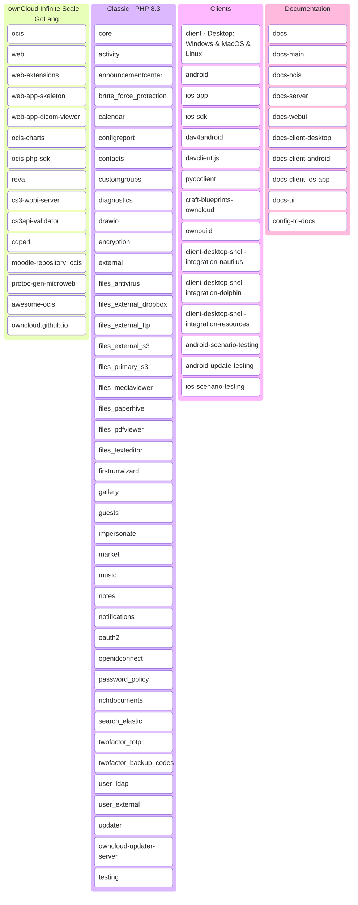

# [ownCloud](https://owncloud.com) - a [Kiteworks](https://kiteworks.com) Company

**The open source Enterprise File Sync and Share OG**
We started self-hosted file sync and share in 2010. We've been through two forks, an acquisition, and two years of heads-down engineering. We shipped a release every quarter. Rebuilt our CI/CD on GitHub Actions. Updated our clients. And stayed quiet.

That changes on **May 5th, 2026**.

🚀 **Something is coming.** New governance. New policies. New commitment — in writing, in public. The way open source should be.

Oh, and ownCloud Classic? **PHP 8.3.** You asked. We listened.

---

### Repository Map

108 public repos across two platforms, four clients, and shared infrastructure.

---

### Links

[Developer Documentation](https://owncloud.dev) · [Documentation](https://doc.owncloud.com/) · [Matrix Messenger](https://app.element.io/#/room/#ocis:matrix.org) · [Forum](https://central.owncloud.org) · [Docker Hub](https://hub.docker.com/r/owncloud) · 
[Security](https://security.owncloud.com) · [OSPO](mailto:ospo@kiteworks.com) · [Community Events](https://owncloud.com/community-events/)

---
ownCloud is maintained by [Kiteworks](https://kiteworks.com) through its Open Source Program Office. 
